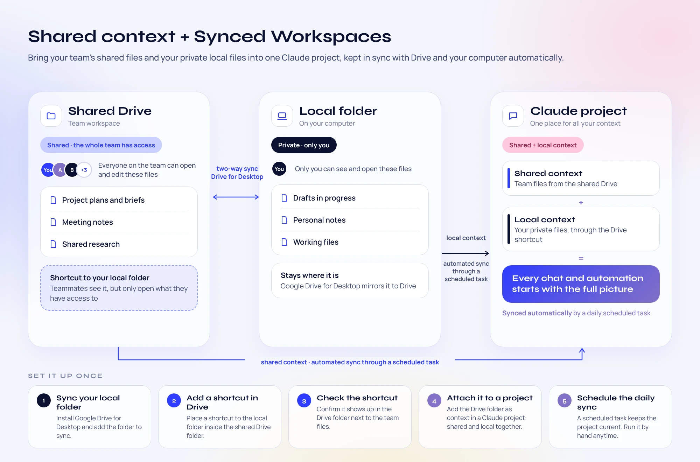

# Shared Context Sync

**Bring your team's shared files and your private local files into one Claude Project, kept in sync with Google Drive and your computer automatically.**



Shared Context Sync is a Claude plugin with one skill, `drive-project-sync-setup`. It walks you through linking a shared Google Drive folder and a private folder on your computer, attaches both to a Claude Project, and creates a daily scheduled task that keeps the Project current. Every chat and automation in that Project starts with the full picture.

## Why

Your context is split in two places:

| | Shared Drive | Local folder |
|---|---|---|
| **Who can see it** | The whole team | Only you |
| **What lives there** | Project plans and briefs, meeting notes, shared research | Drafts in progress, personal notes, working files |
| **How it gets to Claude** | Attached to the Project from Drive | Mirrored to Drive by Google Drive for Desktop, then linked in with a shortcut |

Uploading files to a Project by hand goes stale the moment someone edits a doc. This plugin keeps one Claude Project in sync with both sources, every day, without you touching it.

## How it works

1. **Google Drive for Desktop** mirrors your local folder to Drive. It stays where it is on your computer (two-way sync).
2. **A shortcut** to that folder sits inside the shared Drive project folder. Teammates see the shortcut but can only open what they already have access to.
3. **The Claude Project** has the Drive project folder attached, so it gets the shared files and your local files together.
4. **A daily scheduled task** walks the Drive folder (native files, shortcuts and symlinks), writes one Markdown snapshot per file into the Project, removes snapshots for deleted files, and updates `claude/context.md` with a folder tree, a summary and an update log.

## Set it up once

The skill guides each manual step one at a time, checks it with tools before moving on, and does everything else itself.

1. **Sync your local folder.** Install Google Drive for Desktop and add the folder to sync.
2. **Add a shortcut in Drive.** Place a shortcut to the local folder inside the shared Drive project folder.
3. **Check the shortcut.** Confirm it shows up in the Drive folder next to the team files.
4. **Attach it to a project.** Add the Drive folder as context in a Claude Project, so shared and local files arrive together.
5. **Schedule the daily sync.** A scheduled task keeps the Project current. Run it by hand any time.

## Install

Clone this repo and add it as a plugin in Claude (Claude desktop app or Claude Code):

```bash
git clone https://github.com/anna-hovhan/shared-context-sync.git
```

Then, in a chat inside the Claude Project you want to keep in sync, ask Claude to run **drive-project-sync-setup**, or say something like "set up Drive to Project sync".

### Requirements

- The Claude desktop app, on the computer that holds the local folder
- Google Drive for Desktop
- The Google Drive connector enabled in Claude (Google Docs, Sheets and Slides connectors are used if available)
- Scheduled tasks available on your Claude plan

## What the daily sync does

- Resolves the root folder and any linked folders on every run; nothing is hardcoded in the prompt
- Follows Drive shortcuts and local symlinks, with loop protection
- Reads Google Docs, Sheets and Slides through their connectors
- Mirrors the Drive tree into the Project under `<ROOT>/`, including empty folders (`_folder.md`)
- Handles adds, edits, renames, moves and deletes, then verifies the Project matches Drive path by path
- Keeps a **sync registry** in `claude/context.md` that you can edit to add linked folders by hand
- Sends a notification only when something changed or failed

## Good to know

- Your computer must be awake, online and running the Claude desktop app when the task runs.
- If you move or rename the Drive project folder on disk, the task loses access. Rerun the skill or update the task's folder access.
- Drive is the source of truth. The sync never edits your Drive or local files; it only writes to the Claude Project.

## Repository layout

```
.claude-plugin/plugin.json                  Plugin manifest
skills/shared-context-sync-setup/SKILL.md   The setup skill and the daily sync prompt
assets/                                     README visual
```
